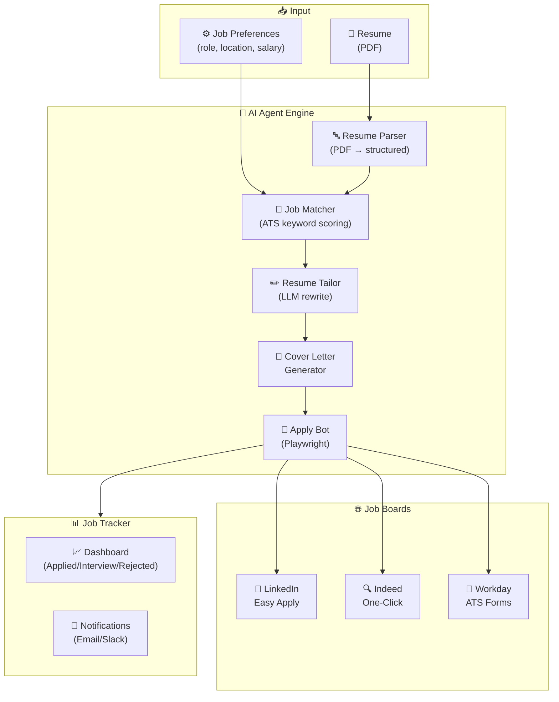
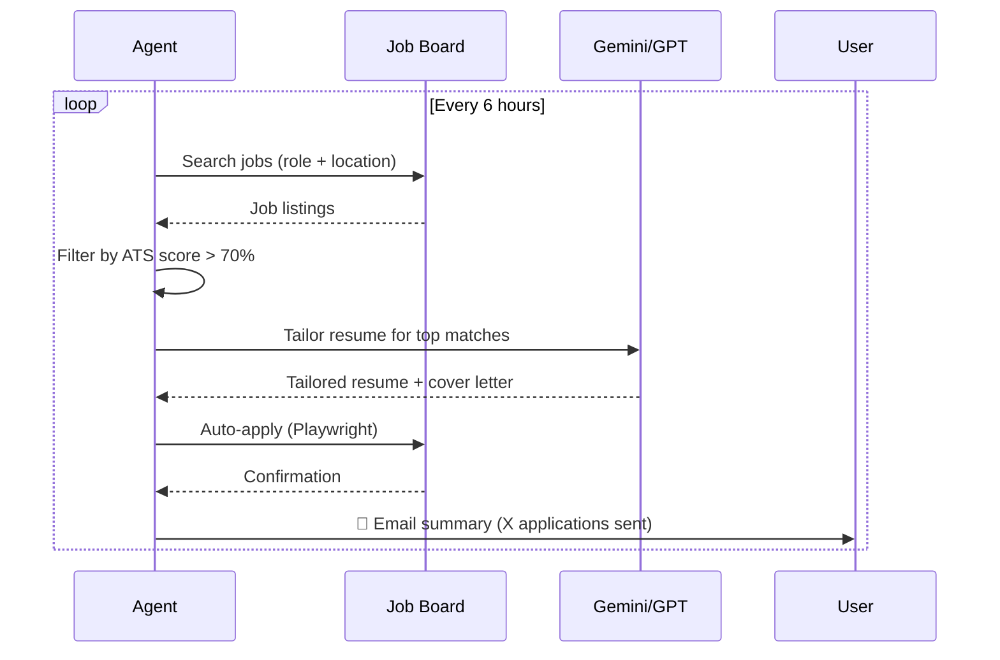

<div align="center">

# 💼 AI Job Agent

**Autonomous AI-Powered Job Application System**

[](https://github.com/harinish45/ai-job-agent/actions/workflows/ci.yml)
[](LICENSE)
[](https://python.org)
[](docker-compose.yml)

> *Upload your resume once — the agent finds jobs, tailors your application, and auto-applies 24/7*

[📋 TODO](TODO.md) · [🚀 DEPLOY](DEPLOY.md) · [📄 PRD](PRD.md)

</div>

---

## 🏗️ Architecture



---

## 🔄 Agent Loop



---

## 🚀 Quick Start

```bash
git clone https://github.com/harinish45/ai-job-agent.git
cd ai-job-agent
./setup.sh

# Or Docker
docker compose up --build
```

---

## 🌐 Deployment Options

| Platform | Config | Command |
|----------|--------|---------|
| Docker | `docker-compose.yml` | `docker compose up` |
| Fly.io | `fly.toml` | `fly deploy` |
| Railway | `railway.toml` | `railway up` |
| Render | `render.yaml` | Auto-deploy |
| Vercel | — | `./deploy-vercel.sh` |

---

<div align="center">
⚠️ Use responsibly — respect platform ToS · <a href="LICENSE">MIT License</a>
</div>